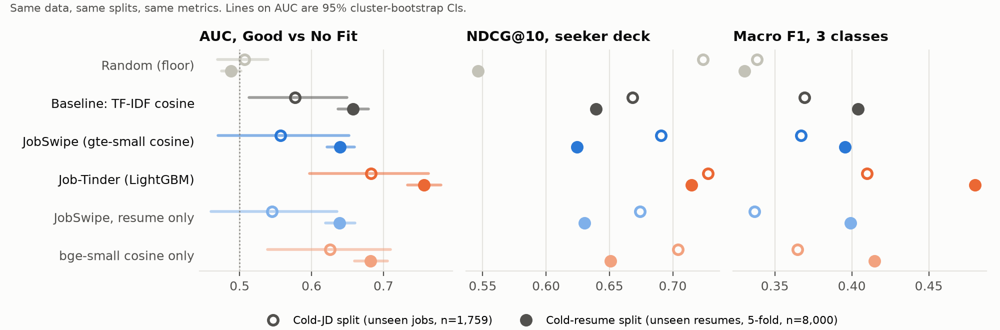

# D3 Modeling Note: Resume–Job Fit Scoring

**DTSC3602 Group 9 · "Tinder for Jobs"** · Evaluation code: `eval/run_evaluation.py` (see `README.md` to reproduce)

## 1. Task and models

Each swipe deck is ordered by a fit score between a resume and a job description. The group has two working implementations. This note compares them with a baseline under a single protocol.

| Role | Model | How it scores a pair |
|---|---|---|
| **Baseline** | TF-IDF cosine | Word-overlap similarity of resume and JD. Nothing is trained. |
| **Candidate A** | JobSwipe (`Baguirr1/jobswipe`) | gte-small (384-d) cosine. The profile vector is 50% a header (title, skills and summary suggested from the resume) and 50% up to two ~1,500-char resume chunks. The job vector covers the JD's first 1,500 chars. Zero-shot. |
| **Candidate B** | Job-Tinder (`awalla63/Job-Tinder-Test-build`) | LightGBM (3-class) on 11 pairwise features: bge-small cosine with the JD chunked and pooled, TF-IDF cosine, skill overlap/coverage, years and seniority gaps. The score is 0.5·P(Potential) + P(Good). |

Both candidates are scored as shipped, not reimplemented. JobSwipe's input strings are generated by its own TypeScript (`embeddings.ts`, `resumeExtract.ts`). Job-Tinder's features, hyper-parameters and seeds are imported from its repo, and its model is retrained inside every training fold. As a check, the harness reproduces Job-Tinder's own reported numbers exactly (AUC 0.683 / 0.756). Three reference rows give context but are not candidates: random scores, JobSwipe with a resume-only profile, and bge-small cosine without the learned layer.

## 2. Validation protocol (identical for every model)

- **Data.** `cnamuangtoun/resume-job-description-fit` has 8,000 human-labelled pairs: No Fit 50%, Potential Fit 25%, Good Fit 25%. It contains only 643 unique resumes and 351 unique JDs, so rows are not independent.
- **Cold-JD split.** This is the dataset's own split. No test JD appears in training (n = 1,759, 69 JDs). It mirrors scoring newly posted jobs.
- **Cold-resume split.** 5-fold GroupKFold by resume with out-of-fold predictions (n = 8,000). It mirrors a new user uploading a resume, and it is the **primary split** because it has 4.5× the test rows and much tighter intervals.
- **Metrics.** AUC for Good vs No Fit (ranking quality), 3-class macro F1, NDCG@10 per resume (the seeker deck) and per JD (the employer deck), and the share of No Fit jobs among each seeker's top 5 cards. AUCs carry 95% **cluster** bootstrap CIs (resampling whole resumes or JDs, 1,000 reps), and model gaps are tested with paired bootstrap CIs on the same resamples.
- **Thresholds for the untrained models.** They output a score, not a class. For macro F1 they are cut into three classes at the training fold's label mix. This is the most generous rule available without seeing test labels.

## 3. Results

| Model | AUC (95% CI) | Macro F1 | NDCG@10 seeker | NDCG@10 employer | No Fit in top 5 ↓ |
|---|---|---|---|---|---|
| *Cold-resume split (primary), n = 8,000* | | | | | |
| Random (floor) | 0.488 | 0.330 | 0.546 | 0.517 | 53.7% |
| Baseline: TF-IDF cosine | 0.658 (0.637–0.679) | 0.404 | 0.639 | 0.646 | 48.2% |
| A: JobSwipe | 0.639 (0.622–0.659) | 0.396 | 0.624 | **0.670** | 45.8% |
| **B: Job-Tinder LightGBM** | **0.756 (0.734–0.780)** | **0.480** | **0.715** | 0.648 | **41.4%** |
| *Cold-JD split, n = 1,759* | | | | | |
| Baseline: TF-IDF cosine | 0.577 (0.513–0.649) | 0.369 | 0.668 | 0.606 | 46.2% |
| A: JobSwipe | 0.557 (0.470–0.652) | 0.367 | 0.691 | **0.658** | 47.8% |
| **B: Job-Tinder LightGBM** | **0.683 (0.597–0.763)** | **0.410** | **0.728** | 0.655 | **43.7%** |

**Paired AUC gaps** (95% CI). Job-Tinder minus baseline: **+0.098 (+0.076, +0.120)** cold-resume and **+0.106 (+0.057, +0.153)** cold-JD. Both intervals exclude 0. JobSwipe minus baseline: −0.019 (−0.039, +0.002) and −0.020 (−0.116, +0.068), so it is not distinguishable from word overlap and leans worse. Job-Tinder minus JobSwipe: +0.117 (+0.094, +0.139) and +0.126 (+0.038, +0.212).

## 4. Selected model: Job-Tinder LightGBM

It is the only candidate that clearly beats the baseline, on both splits, and it leads on AUC, macro F1, seeker NDCG and bad cards in the top 5. Its seeker decks have about 7 points fewer No Fit cards in the top 5 than the baseline (41% vs 48%), which is the improvement a user would see. It is also cheap to run: 11 features and a small tree ensemble on CPU.

**Why JobSwipe underperforms, despite being the more finished app.** The issue is the scoring model, not the app. Its scorer is an untrained cosine, and the ablations show where it loses ground. (a) The resume-suggestion header adds nothing: +0.001 AUC versus a resume-only profile. On this data JobSwipe's rule-based extractor finds a job title for only 141 of 643 resumes (22%), because the section headings run into the text ("SummaryHighly motivated…"). (b) The encoder and text handling matter. bge-small cosine with Job-Tinder's JD chunking beats JobSwipe's gte-small cosine by 0.043 AUC (CI −0.065 to −0.021, cold-resume). (c) Similarity alone can't express "right field, wrong level". Job-Tinder's learned layer adds a further +0.074 over its own cosine. JobSwipe's one strength is **employer-side NDCG** (0.670, best of the three compared models): it ranks candidates for a fixed posting well, even though it ranks postings for a fixed candidate poorly.

## 5. Error analysis (cold-resume out-of-fold predictions)

1. **High skill overlap is where similarity models fail.** When the resume covers more than 50% of the job's listed skills (n = 803), JobSwipe's AUC falls to **0.432, below random**, with a severe-error rate (No Fit predicted Good, or Good predicted No) of 27%. Job-Tinder rises to 0.785 with 12% severe errors. In these pairs the field already matches, so fit depends on level. JobSwipe's most confident mistakes show this: a "Lead Data Engineer, 8–10 years" JD ranked top for data engineers with about 3 years of experience.
2. **Experience-heavy jobs are hardest for everyone.** For JDs requiring 6+ years, AUC is 0.604 for the baseline, 0.563 for JobSwipe and 0.696 for Job-Tinder. Job-Tinder's severe-error rate peaks here (25.5%). Its years and seniority features help, but regex-parsed years are crude.
3. **Long job descriptions.** For JDs over 3,000 characters (41% of pairs), JobSwipe drops to 0.592 from 0.686 on JDs it reads in full. It embeds only the first 1,500 chars, and its lowest-ranked true Good Fits are postings that open with a paragraph of company boilerplate. The baseline drops by a similar amount, so long JDs are harder in general. Job-Tinder pools every chunk and degrades least (0.765 → 0.733).
4. **Seniority groups.** Job-Tinder is best in every seniority group with n ≥ 150. JobSwipe beats the baseline on intern postings (0.733 vs 0.640) and on postings with no stated seniority (0.754 vs 0.635), but it is far worse on mid-level postings (0.549 vs 0.718).
5. **The middle class is not learned.** Job-Tinder recalls only 26% of Potential Fit pairs, and 57% of them are predicted No Fit. Every model is weakest on this class.
6. **JobSwipe's "% match" badge.** Raw cosines span only 0.80–0.95, and the median badge would read 48% for No Fit pairs, 54% for Good Fit and 55% for Potential Fit (`results/figures/fig3_jobswipe_badge.png`). Potential Fit outranks Good Fit, and 4.2% of No Fit pairs would display ≥ 70%, close to the 5.7% for Good Fit pairs. The badge should not be read as a probability.
7. **Some confident errors look like label noise.** Job-Tinder's highest-scored No Fit pairs are senior accountants matched to a "Senior Construction Accountant" posting. Its lowest-scored Good Fits include template recruiter emails ("Greetings from DevCare Solutions…") and resumes with corrupted text.

## 6. Limitations

- **Home-field advantage.** The labelled set is Job-Tinder's training source, so Job-Tinder learns these annotators' notion of fit, while JobSwipe is zero-shot. Cold splits prevent row leakage but not this distribution advantage. The comparison answers "which scorer best predicts these labels", not "which app gives better recommendations".
- **Small effective sample.** 643 resumes and 351 JDs. The cold-JD test set has only 69 JDs, so its CIs are wide (±0.08). Its seeker NDCG is uninformative: with few jobs per resume, random scores already reach 0.724.
- **Labels.** Three ordinal levels from an unspecified annotation process. The Potential Fit boundary is poorly separable, and some apparent errors are probably label noise.
- **Faithfulness of the JobSwipe reproduction.** We used the fp32 `thenlper/gte-small` weights rather than Supabase's ONNX runtime, which may differ very slightly. We simulated a seeker who accepts every resume suggestion. The dataset JDs have no title, skills or location fields, so JobSwipe's structured job header was empty here, though it is filled in production.
- **Not evaluated.** Survey preferences (salary, location, remote), which both apps apply as hard filters. Real swipe behaviour, since all metrics are offline. Demographic fairness, since the data has no demographic fields. The error groups themselves come from regex parsing and are noisy, and groups with n < 150 are excluded from conclusions.

## 7. Recommendation

Ship Job-Tinder's LightGBM scorer as the ranking model, behind whichever front end the group keeps. If JobSwipe's app is kept, its two cheapest fixes are to chunk and pool the full JD instead of truncating at 1,500 characters, and to rescore its top-k with the LightGBM model. The next modeling priority is the high-skill-overlap, high-experience cases from §5.1–5.2: better years and seniority extraction would target exactly where the selected model still fails.
