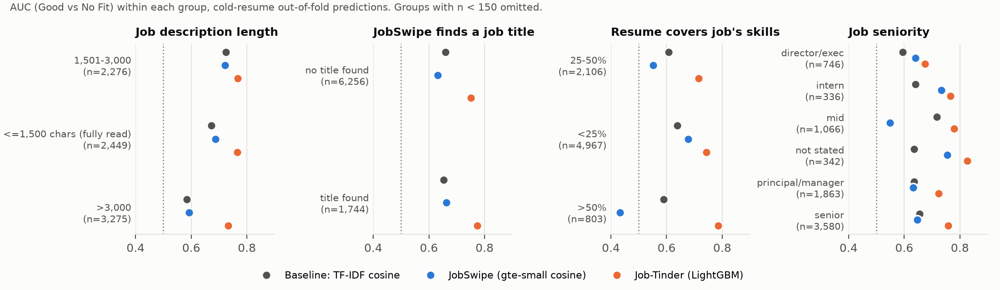

# D3 Modeling Note: Resume–Job Fit Scoring

**DTSC3602 Group 9 · "Tinder for Jobs"** · Evaluation code: `D3_Model_Evaluation.ipynb` (or `eval/`; see `README.md`)

## 1. Task and models

Each swipe deck is ordered by a fit score between a resume and a job posting. The group has two working implementations. This note compares them with a baseline under one protocol.

| Role | Model | How it scores a pair |
|---|---|---|
| **Baseline** | TF-IDF cosine | Word-overlap similarity of resume and posting. Nothing is trained. |
| **Candidate A** | JobSwipe (`Baguirr1/jobswipe`) | gte-small (384-d) embedding cosine. The profile vector is 50% a header suggested from the resume (title, skills, summary) and 50% up to two ~1,500-char resume chunks. The job vector covers the title, location and the first 1,500 chars of the description. Zero-shot. |
| **Candidate B** | Job-Tinder (`awalla63/Job-Tinder-Test-build`) | LightGBM (3-class) on 11 pairwise features: bge-small cosine with the posting chunked and pooled, TF-IDF cosine, skill overlap, and years and seniority gaps. The score is 0.5·P(Potential) + P(Good). |

Both candidates run as shipped, not reimplemented. JobSwipe's input strings come from its own TypeScript. Job-Tinder's features, hyper-parameters and seeds are imported from its repo. As a check, the harness reproduces Job-Tinder's own reported AUCs exactly (0.683 / 0.756).

## 2. Validation: two tests, biased in opposite directions

**Test 1: labelled fit data.** `cnamuangtoun/resume-job-description-fit` has 8,000 human-labelled pairs (No Fit 50%, Potential Fit 25%, Good Fit 25%), built from only 643 resumes and 351 job descriptions. There are two splits:

- **Cold-resume** (primary): 5-fold GroupKFold by resume, with out-of-fold predictions (n = 8,000).
- **Cold-JD**: the dataset's own split, with no test JD seen in training (n = 1,759).

Job-Tinder is retrained inside every training fold. Metrics are AUC for Good vs No Fit with 95% cluster-bootstrap CIs, 3-class macro F1, NDCG@10 per resume and per JD, and the share of No Fit jobs in each seeker's top 5. *Bias:* this is Job-Tinder's own training source, and its design was tuned on it.

**Test 2: neutral ground.** These are data neither model was trained on: 240 Kaggle resumes (10 in each of 24 categories) and real LinkedIn postings. For each resume, every model ranks the same 50 postings, 10 in the resume's field (the posting title matches the resume's category) and 40 not. Job-Tinder is scored with its **shipped** model files, and JobSwipe gets real titles and locations. Metrics are per-resume AUC for in-field vs out-of-field, precision@10, NDCG@10, and the share of the top 10 with a severe seniority mismatch (≤ 2 years of experience shown a Director/Executive role, or ≥ 10 years shown an intern/entry role). CIs come from bootstrapping over resumes. *Bias:* the label measures field match only, which is what similarity scores are built to capture.

## 3. Results

**Test 1, labelled fit data**

| Model | AUC (95% CI) | Macro F1 | NDCG@10 seeker | NDCG@10 employer | No Fit in top 5 ↓ |
|---|---|---|---|---|---|
| *Cold-resume split, n = 8,000* | | | | | |
| Random | 0.488 | 0.330 | 0.546 | 0.517 | 53.7% |
| Baseline: TF-IDF | 0.658 (0.637–0.679) | 0.404 | 0.639 | 0.646 | 48.2% |
| A: JobSwipe | 0.639 (0.622–0.659) | 0.396 | 0.624 | **0.670** | 45.8% |
| B: Job-Tinder | **0.756 (0.734–0.780)** | **0.480** | **0.715** | 0.648 | **41.4%** |
| *Cold-JD split, n = 1,759* | | | | | |
| Baseline: TF-IDF | 0.577 (0.513–0.649) | 0.369 | 0.668 | 0.606 | 46.2% |
| A: JobSwipe | 0.557 (0.470–0.652) | 0.367 | 0.691 | **0.658** | 47.8% |
| B: Job-Tinder | **0.683 (0.597–0.763)** | **0.410** | **0.728** | 0.655 | **43.7%** |

**Test 2, neutral ground (240 resumes × 50 postings)**

| Model | AUC (95% CI) | In-field in top 10 | NDCG@10 | Seniority mismatch in top 10 ↓ |
|---|---|---|---|---|
| Random | 0.503 | 19.8% | 0.195 | 18.3% |
| Baseline: TF-IDF | 0.692 (0.668–0.715) | 40.8% | 0.439 | 15.5% |
| **A: JobSwipe** | **0.708 (0.682–0.734)** | **42.5%** | **0.443** | **14.9%** |
| B: Job-Tinder | 0.660 (0.639–0.679) | 36.0% | 0.393 | 16.0% |

**Paired gaps in AUC** (95% CI):

| Comparison | Test 1, cold-resume | Test 1, cold-JD | Test 2 |
|---|---|---|---|
| Job-Tinder − baseline | **+0.098 (+0.076, +0.120)** | **+0.106 (+0.057, +0.153)** | **−0.032 (−0.049, −0.016)** |
| JobSwipe − baseline | −0.019 (−0.039, +0.002) | −0.020 (−0.116, +0.068) | +0.016 (−0.004, +0.037) |
| Job-Tinder − JobSwipe | +0.117 (+0.094, +0.139) | +0.126 (+0.038, +0.212) | −0.048 (−0.071, −0.029) |

**Job-Tinder's ranking flips between the two tests, and both flips are statistically significant.** It clearly beats the baseline on the data it was built on, and it is clearly worse on data it wasn't. Job-Tinder's own repo reaches the same conclusion in its own in-domain test: its LightGBM gets 27% in-field jobs in the top 10, against 35% for TF-IDF and 37% for plain embedding cosine. JobSwipe stays statistically tied with the baseline on both tests. It ranks best by point estimate on neutral ground, where it wins in 15 of 24 resume categories (TF-IDF wins 7, Job-Tinder 2). No model meaningfully reduces seniority mismatches.

## 4. Selected model: embedding similarity (JobSwipe)

We select **JobSwipe's embedding-similarity ranking**, with the TF-IDF baseline as a statistically equivalent fallback. We do **not** select Job-Tinder's LightGBM, despite its Test 1 numbers.

- **Robustness beats in-distribution accuracy.** The app serves new resumes and real postings, the setting of Test 2. Job-Tinder's learned layer adds +0.074 AUC over its own cosine on its training distribution, but on new data it lowers ranking quality significantly. A model whose gain disappears outside its training set is not earning its complexity, and Job-Tinder's own gate rule makes the same point: ship cosine when the model can't beat it.
- **JobSwipe never loses to the baseline.** It is level with TF-IDF on both tests and has the best point estimates on neutral ground and on employer-side ranking. It is zero-shot, so it has no train/serve skew, and it already runs inside the more finished app.
- **The honest caveat:** JobSwipe has not been shown to *beat* TF-IDF on either test. It is selected for robustness and product fit, not proven superiority.

## 5. Error analysis

From the out-of-fold Test 1 predictions (figure below) and from Test 2:

1. **Similarity can't judge level.** When a resume covers more than 50% of a job's skills, so the field already matches, JobSwipe's AUC falls to **0.432, below random**, with 27% severe errors. Its most confident mistakes are a "Lead Data Engineer, 8–10 years" posting ranked top for engineers with about 3 years of experience. Job-Tinder handles these pairs (AUC 0.785) on Test 1. Test 2 shows that this skill doesn't transfer, because no model reduces seniority mismatches there.
2. **Experience-heavy jobs are hardest for everyone.** For JDs requiring 6+ years, AUC is 0.604 for the baseline, 0.563 for JobSwipe and 0.696 for Job-Tinder.
3. **Truncation.** On JDs over 3,000 characters, JobSwipe drops to 0.592, from 0.686 on JDs it reads in full. It embeds only the first 1,500 characters, and the postings it misses often open with company boilerplate.
4. **Resume parsing.** JobSwipe's rule-based extractor found a job title for only 22% of the Test 1 resumes and 15% of the Test 2 resumes. The suggested header adds nothing (+0.001 AUC versus resume only).
5. **Weak categories.** On Test 2, JobSwipe falls below random for ADVOCATE (0.36) and HEALTHCARE (0.46). Those categories' title patterns ("legal", "care", "health") are broad, so part of this is label noise. With 10 resumes per category, results by category are indicative only.
6. **The "% match" badge.** JobSwipe's raw cosines span only 0.80–0.95. The median badge would read 48% for No Fit pairs and 54% for Good Fit pairs (`results/figures/fig3_jobswipe_badge.png`), so it should not be read as a probability.
7. **The middle class.** Every model is weakest on Potential Fit. Job-Tinder recalls 26% of those pairs.

## 6. Limitations

- **Each test favors a different model.** Test 1 is Job-Tinder's training source. Test 2's label (title matches field) rewards topical similarity and can't credit level judgement. Neither test measures true fit on the app's own data. Only hand-labelled pairs from the app's postings would do that, and that is the most valuable next step.
- **Small samples.** Test 1 has 643 resumes and 351 JDs, and its cold-JD test set has only 69 JDs, giving CIs of about ±0.08. Test 2 has 240 resumes, 10 per category.
- **Proxy labels and parsing.** Test 1's labels come from an unspecified annotation process, and some confident errors look like label noise. Test 2's field labels and seniority flags come from regular expressions.
- **Reproduction details.** JobSwipe was run with fp32 `thenlper/gte-small` weights rather than Supabase's ONNX runtime. We simulated a seeker who accepts every suggestion from their resume.
- **Not evaluated.** Survey preferences (salary, location, remote), which both apps apply as hard filters; real swipe behaviour; and demographic fairness, since neither dataset has demographic fields.

## 7. Recommendation

Ship embedding-similarity ranking (JobSwipe's approach). The cheapest improvements are to chunk and pool the full posting instead of truncating at 1,500 characters, and to test bge-small, which beat gte-small by 0.043 AUC on Test 1, on neutral ground. Keep Job-Tinder's LightGBM out of the ranking path until it beats plain similarity on held-out data from the app's own domain. Its years and seniority features are the right idea for the level-matching failures in §5.1, but they need training labels that look like the app's data.
